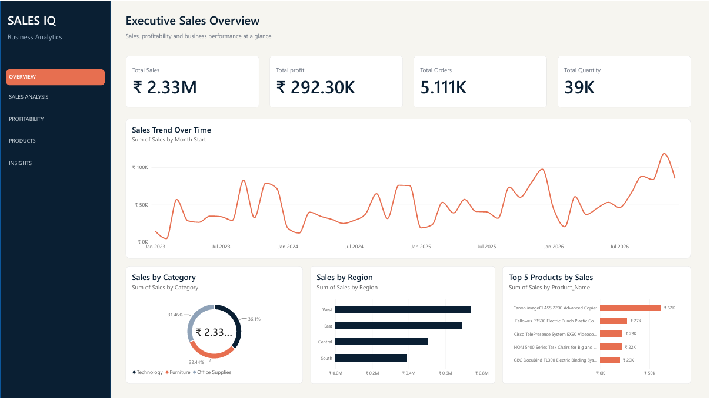
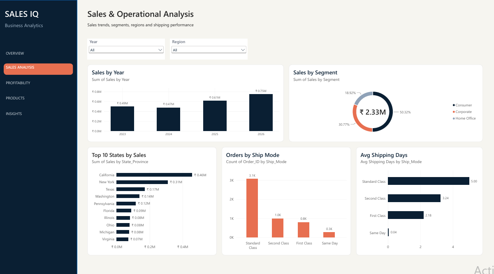
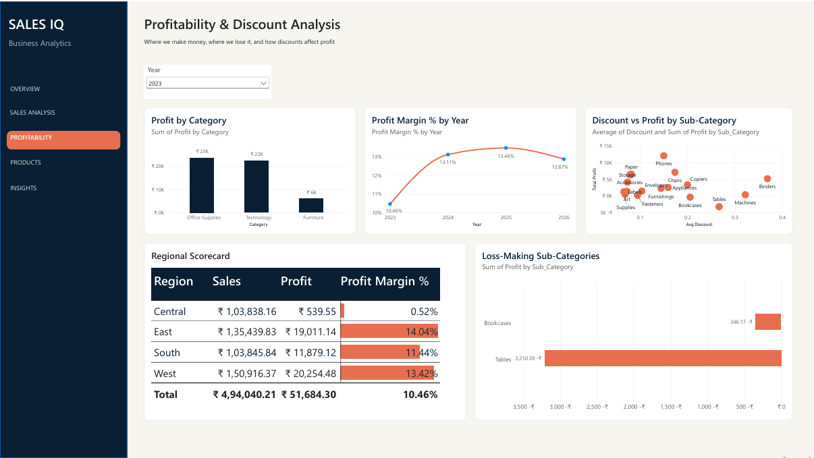
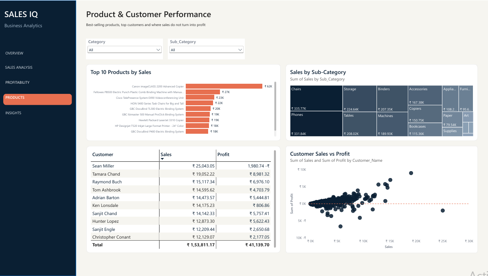
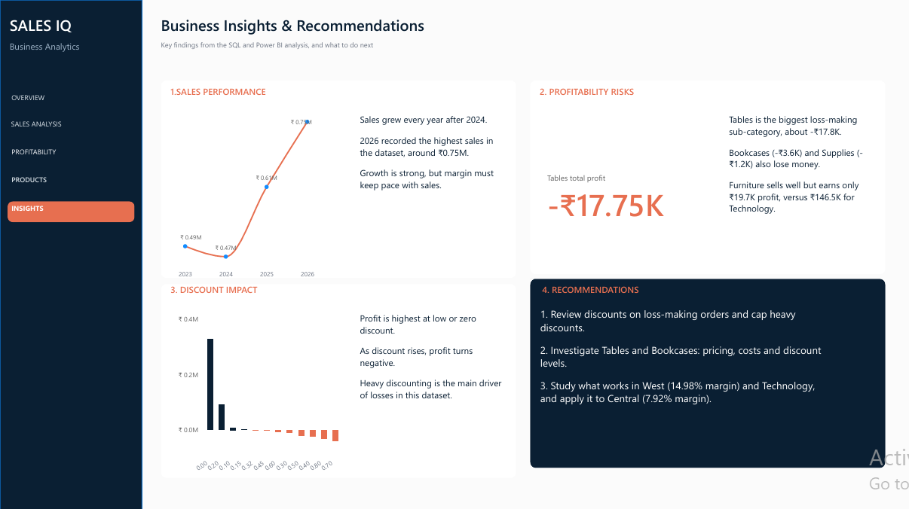

# SALES IQ: Sales & Profit Analytics (MySQL + Power BI)

An end-to-end data analytics project: retail orders data validated and analysed in **MySQL**, then turned into a 5-page interactive **Power BI** dashboard with business insights and recommendations.

## Objective
Find out where the business makes money, where it loses it, and what to do about it.

## Dataset
- Retail orders data, 10,194 rows, orders from 2023 to 2026
- Key columns: Order_Date, Ship_Date, Category, Sub_Category, Region, Segment, Customer_Name, Product_Name, Sales, Profit, Discount, Quantity

## Tools
- MySQL 8.0 and MySQL Workbench (validation and analysis)
- Power BI Desktop (DAX measures, interactive dashboard)

## Project workflow
1. Loaded the CSV into MySQL and validated it (row count, data types, NULL check, duplicate check)
2. Wrote 17 SQL analyses to answer business questions (see `sql/`)
3. Connected Power BI to MySQL and built 5 report pages
4. Wrote insights and recommendations

## SQL analyses
Data validation, Sales and Profit by Category, Sales by Region, Sales by Segment, Top Products by Sales and Profit, Sales and Profit by Sub-Category, Sales and Profit by Year, Profit Margin by Year, Loss-making Sub-Categories, Discount vs Profit, Shipping Performance, Monthly Sales Trend, Top Customers, Regional Profitability.

## Dashboard pages
| Page | Question it answers |
|---|---|
| Overview | How is the business performing? |
| Sales Analysis | Where do sales come from? |
| Profitability | Where do we make and lose money? |
| Products | Which products and customers matter? |
| Insights | What should the business do? |

### Overview

### Sales Analysis

### Profitability

### Products

### Insights

## Key findings
- Total sales about 2.33M, total profit about 292.3K, overall profit margin about 12.56%
- Technology is the most profitable category. Furniture sells well but earns very little profit
- West has the best margin (14.98%). Central has the lowest (7.92%)
- Higher discounts are linked with negative profit
- Tables is the biggest loss-making sub-category (about -17.75K), followed by Bookcases and Supplies
- Some top customers by sales, such as Sean Miller, generated a loss
- Sales grew strongly in 2025 and 2026

## Recommendations
1. Review discounts on loss-making orders and cap heavy discounts
2. Investigate pricing and costs of Tables and Bookcases
3. Learn from West and Technology and apply it to Central

## Repository structure
- `sql/sales_analytics_queries.sql`: all SQL queries
- `powerbi/SALES_ANALYTICS.pbix`: Power BI report
- `powerbi/SALES_IQ_Dashboard.pdf`: PDF export of the report
- `images/`: dashboard screenshots

## Author
Nandana Gopan | [LinkedIn](https://www.linkedin.com/in/nandana-gopan-a6b136359/) | nandanagopan2504@gmail.com
